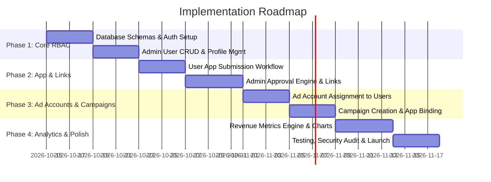

# Product Requirement Document (PRD)
## Multi-Tenant App & Ad Revenue Management Platform

* **Document Version:** 1.0.0
* **Status:** Approved / Ready for Architecture
* **Target Audience:** Engineering, Product, UI/UX, Stakeholders

---

## 1. Executive Summary & Product Overview

### 1.1 Objective
The **Multi-Tenant App & Ad Revenue Management Platform** is a centralized web dashboard designed to bridge the operational workflow between Platform Administrators and Publishers/App Owners (Users). It streamlines app onboarding, approval governance, tracking link distribution, ad account provisioning, and downstream revenue/campaign analytics.

### 1.2 Problem Statement
- App onboarding, tracking link distribution, and ad account assignments are currently disorganized and managed through fragmented manual channels.
- App publishers lack a single unified portal to monitor approved links, connect campaigns, and measure incoming ad revenue in real-time.
- Administrators need a secure, role-restricted control tower to govern user accounts, validate submitted applications, attach tracking links, and manage ad account associations.

### 1.3 Key Value Propositions
* **End-to-End App Lifecycle:** Structured submission $\to$ review $\to$ approval $\to$ dynamic link allocation.
* **Strict Role-Based Data Isolation:** Secure multi-tenant architecture ensuring users only view apps, ad accounts, and revenue figures explicitly assigned to them.
* **Operational Efficiency:** Automated distribution of tracking links and ad accounts eliminating manual overhead.
* **Actionable Revenue Insights:** Clear data visualization of earnings, performance indicators, and campaign attribution.

---

## 2. User Roles & Personas

| Role | Persona | Core Responsibilities |
| :--- | :--- | :--- |
| **Admin** | Operations & Platform Manager | User account provisioning, app approvals/rejections, assigning tracking links to apps, associating ad accounts to users. |
| **User** | App Publisher / Growth Partner | Profile maintenance, app submission, retrieving assigned links, binding campaigns to apps, monitoring revenue and performance metrics. |

---

## 3. Role-Based Access Control (RBAC) Matrix

| Feature / Resource | Action | Admin | User | Rules & Constraints |
| :--- | :--- | :---: | :---: | :--- |
| **Users** | Create | ✅ | ❌ | Admin provisions `name`, `email`, `password`. |
| | View All | ✅ | ❌ | Admin views all registered publishers. |
| | Delete | ✅ | ❌ | Soft-delete with cascading deactivation. |
| **Profile** | Update Profile / Password | ✅ | ❌ | Users can only modify their own credentials. |
| **Apps** | Submit for Approval | ❌ | ✅ | Users can submit apps with package/bundle details. |
| | Review (Approve/Reject) | ✅ | ❌ | Admin accepts/rejects with optional reason notes. |
| | View Apps | ✅ (All) | ✅ (Owned) | Users only see their submitted apps and status. |
| **App Links** | Assign Links | ✅ | ❌ | Admin assigns one or more URLs/tracking links per app. |
| | View Assigned Links | ✅ | ✅ (Owned) | Users view assigned links only for *Approved* apps. |
| **Ad Accounts** | Assign to User | ✅ | ❌ | Admin assigns external ad accounts to user profiles. |
| | Remove from User | ✅ | ❌ | Admin unlinks ad accounts. |
| | View Ad Accounts | ✅ (All) | ✅ (Assigned) | Users view active ad accounts connected to their profile. |
| **Campaigns** | Assign to App | ❌ | ✅ | Users map ad campaigns to their approved apps. |
| **Revenue Metrics** | View Metrics | ✅ (Global) | ✅ (Filtered) | Users only view revenue generated by their apps & ad accounts. |

---

## 4. Functional Specifications

### 4.1 Admin Module

#### 4.1.1 User Management
- **Create User:**
  - Fields: `Full Name` (required), `Email Address` (unique, valid email format), `Initial Password` (min 8 chars, hashed via bcrypt/argon2), `Status` (Active/Suspended).
  - Validation: Real-time duplicate email verification.
- **View All Users:**
  - Data table with columns: ID, Name, Email, Status, Assigned Ad Accounts count, Total Apps count, Created At, Actions.
  - Features: Search by name/email, filter by status, pagination (default 10/25/50 per page).
- **Delete User:**
  - Confirmation modal with safety confirmation text.
  - Soft-deletes user record and safely disables connected app submissions and active sessions.

#### 4.1.2 App Review & Approval Workflow
- **Approval Queue:**
  - Dedicated inbox displaying applications in `PENDING` status.
  - Details visible: App Name, Platform (Android / iOS / Web), Package Name / Bundle ID, Store URL, Submission Date, Submitting User.
- **Approve / Reject Action:**
  - One-click **Approve** transitions state to `APPROVED`.
  - **Reject** opens a dialog requiring a rejection reason code / note visible to the submitting user.
  - Sends immediate notification / status update to the user.

#### 4.1.3 Link Assignment System
- **Assign Links to Apps:**
  - Available for apps in `APPROVED` state.
  - Multi-link support: An app can hold multiple categorized links (e.g., *Tracking URL*, *Fallback URL*, *Deep Link*, *Affiliate Link*).
  - Fields: `Link Title` (e.g., "Branch Deep Link", "AppsFlyer Attribution"), `URL` (validated URL format), `Tag / Type`, `Active Status`.
  - Capability to add, edit, toggle active status, or remove individual links.

#### 4.1.4 Ad Account Management
- **Assign Ad Account:**
  - Searchable picker to select target User and Ad Account ID/Name (e.g., Google Ads CID, Meta Ad Account ID, Unity, AppLovin).
  - Multi-account mapping: A user can be granted access to multiple ad accounts.
- **Remove Ad Account:**
  - Detach ad account association with instantaneous revocation of access on the user's dashboard.

---

### 4.2 User Module

#### 4.2.1 Profile & Security
- **Self-Service Profile:**
  - Update `Full Name`.
  - Change Password: Requires `Current Password`, `New Password`, and `Confirm New Password` with strength validation.

#### 4.2.2 App Submission & Status Tracking
- **App Submission Form:**
  - Fields:
    - `App Name` (e.g., "Speed Racer 3D")
    - `Platform` (Dropdown: Android, iOS, Web, Desktop)
    - `Package Name / Bundle ID` (e.g., `com.company.speedracer`)
    - `Store / Preview URL` (optional initial link)
    - `Notes / Description` (optional context for Admin)
  - Validation against duplicate package names for active apps.
- **My Apps Overview:**
  - Status badges: `PENDING` (yellow), `APPROVED` (green), `REJECTED` (red).
  - If `REJECTED`, displays the admin's rejection explanation with a "Re-submit" action.

#### 4.2.3 Approved App Links
- **Link Hub:**
  - Accessible per approved app.
  - Displays all assigned links with quick "Copy to Clipboard" button, QR code preview (optional), and creation date.
  - Clear indicator if a link is marked active or inactive.

#### 4.2.4 Campaign Management
- **Campaign Assignment:**
  - Users can register or assign marketing/ad campaigns to a specific approved app.
  - Fields: `Campaign Name`, `Target App`, `Ad Network / Source` (Google, Facebook, TikTok, Organic, etc.), `Target Ad Account` (selected from assigned ad accounts), `Budget / Status`.
  - Links campaign parameters to track incoming revenue and conversion data.

#### 4.2.5 Revenue Analytics & Metrics
- **Interactive Metric Cards:**
  - Total Revenue ($), Daily Average ($), eCPM, Impressions, Clicks, Conversion Rate.
- **Visual Analytics:**
  - Time-series Revenue Trend (Day / Week / Month / Custom Date Range).
  - Revenue breakdown by App (Donut / Bar chart).
  - Revenue breakdown by Campaign and Ad Account.
- **Exporting:**
  - Download metrics in CSV / Excel format.

---

## 5. Database Schema & Entity-Relationship Design

```
+------------------+         1:N         +------------------+
|      users       |-------------------->|       apps       |
|------------------|                     |------------------|
| id (PK)          |                     | id (PK)          |
| name             |                     | user_id (FK)     |
| email (Unique)   |                     | name             |
| password_hash    |                     | platform         |
| role (ADMIN/USER)|                     | bundle_id        |
| status           |                     | status (PEN/APP/REJ)
| created_at       |                     | rejection_reason |
+------------------+                     | created_at       |
        |                                +------------------+
        | 1:N (Pivot)                              | 1:N
        v                                          v
+-----------------------+                +------------------+
|   user_ad_accounts    |                |    app_links     |
|-----------------------|                |------------------|
| id (PK)               |                | id (PK)          |
| user_id (FK)          |                | app_id (FK)      |
| ad_account_id (FK)    |                | title            |
| assigned_at           |                | url              |
+-----------------------+                | link_type        |
        | N:1                            | is_active        |
        v                                +------------------+
+-----------------------+                          |
|      ad_accounts      |                          | 1:N
|-----------------------|                          v
| id (PK)               |                +------------------+
| account_name          |                |    campaigns     |
| network (Meta/Google) |                |------------------|
| external_account_id   |--------------->| id (PK)          |
| status                |                | app_id (FK)      |
+-----------------------+                | ad_account_id(FK)|
                                         | name             |
                                         | utm_source       |
                                         | status           |
                                         +------------------+
                                                   |
                                                   | 1:N
                                                   v
                                         +------------------+
                                         | revenue_metrics  |
                                         |------------------|
                                         | id (PK)          |
                                         | app_id (FK)      |
                                         | campaign_id (FK) |
                                         | ad_account_id(FK)|
                                         | date             |
                                         | impressions      |
                                         | clicks           |
                                         | revenue_usd      |
                                         | ecpm             |
                                         +------------------+
```

---

## 6. End-to-End User Journeys

### Journey 1: App Submission to Monetization Link Distribution
1. **User** logs into the dashboard and navigates to **My Apps** $\to$ clicks **"Submit New App"**.
2. **User** fills in App Name, Platform (e.g. Android), and Package ID (`com.game.sample`) and submits.
3. App status enters **`PENDING`**.
4. **Admin** receives notification in **App Approval Queue**.
5. **Admin** reviews credentials and clicks **"Approve"**.
6. **Admin** clicks **"Manage Links"** on the approved app and inserts 2 links:
   - Primary Tracking URL (`https://track.domain.com/c/12345`)
   - Fallback Web Landing Page (`https://game.sample.com`)
7. **User** opens **My Apps**, sees status updated to **`APPROVED`**, clicks into the app, and copies the assigned tracking links for immediate deployment.

### Journey 2: Ad Account Assignment & Campaign Revenue Tracking
1. **Admin** navigates to **Ad Accounts** $\to$ selects **User A** $\to$ clicks **"Assign Ad Account"**.
2. **Admin** selects `Google Ads - Publisher Acc #8821` and confirms.
3. **User A** navigates to **Campaigns** $\to$ clicks **"Create / Assign Campaign"**.
4. **User A** names the campaign "US Android Launch", links it to their approved app and the assigned `Google Ads` account.
5. System records daily incoming ad revenue and performance logs.
6. **User A** views the **Revenue Dashboard**, filtering by date to inspect daily revenue, eCPM, and campaign ROI.

---

## 7. API Architecture Specification

### 7.1 Authentication & Profile
- `POST /api/auth/login` - Authenticate user & issue JWT/Session.
- `POST /api/auth/logout` - Invalidate active session.
- `GET  /api/auth/me` - Retrieve current user profile and role.
- `PUT  /api/user/profile` - Update name / password for current user.

### 7.2 Admin Endpoints
- `GET    /api/admin/users` - Fetch paginated list of users.
- `POST   /api/admin/users` - Provision a new user.
- `DELETE /api/admin/users/:id` - Delete a user.
- `GET    /api/admin/apps/pending` - List all pending app approval requests.
- `PATCH  /api/admin/apps/:id/status` - Approve or reject an app (`status: "APPROVED" | "REJECTED"`, `reason`).
- `POST   /api/admin/apps/:id/links` - Assign a new link to an app.
- `DELETE /api/admin/apps/:id/links/:linkId` - Remove an assigned link.
- `POST   /api/admin/users/:id/ad-accounts` - Assign ad account to user.
- `DELETE /api/admin/users/:id/ad-accounts/:accId` - Remove ad account from user.

### 7.3 User Endpoints
- `GET    /api/user/apps` - List all apps submitted by the authenticated user.
- `POST   /api/user/apps` - Submit a new app for review.
- `GET    /api/user/apps/:id/links` - Fetch assigned links for an approved app.
- `GET    /api/user/ad-accounts` - Fetch assigned ad accounts.
- `GET    /api/user/campaigns` - List campaigns assigned to user's apps.
- `POST   /api/user/campaigns` - Assign/create a campaign for an app.
- `GET    /api/user/analytics/revenue` - Retrieve revenue time-series and summary KPI aggregations.

---

## 8. Non-Functional Requirements (NFRs)

### 8.1 Security
- **Authentication:** Secure cookie-based HTTP-only session tokens or JWT with short expiry and refresh rotation.
- **Passwords:** Minimum 8 characters, hashed with `bcrypt` (cost 12) or `argon2id`.
- **Role Enforcement:** Server-side route middleware verifying user role and tenant ownership before query execution.
- **Input Validation:** Strict Zod/Joi schema validation on every payload.
- **Sanitization:** Escaped output to prevent XSS; parameterized queries preventing SQL injection.

### 8.2 Performance & Scalability
- **API Response Time:** 95% of endpoints resolve in $<200\text{ms}$.
- **Analytics Queries:** Pre-aggregated daily revenue metrics table to ensure sub-second dashboard rendering even with 1M+ raw event rows.
- **Caching:** Cache user session data and global app config using Redis/in-memory cache.

### 8.3 Reliability & Auditability
- **Audit Logs:** Log every admin action (user deletion, app approval/rejection, link assignment, ad account grant/revoke) with timestamp and IP.
- **Uptime Target:** 99.9% availability SLA.

---

## 9. UI/UX Design System & Layout Structure

### 9.1 Visual Theme
- **Color Palette:**
  - Primary Brand: Deep Indigo / Electric Violet (`#6366F1`)
  - Accent / Revenue Positive: Emerald (`#10B981`)
  - Warning / Pending: Amber (`#F59E0B`)
  - Error / Rejected: Rose (`#F43F5E`)
  - Dark Mode Background: Slate Charcoal (`#0B0F17` / `#111827`)
  - Card Glassmorphism: `rgba(255, 255, 255, 0.03)` with subtle `1px solid rgba(255, 255, 255, 0.08)` border
- **Typography:** Inter / Outfit for modern, crisp UI readability.

### 9.2 Navigation Structure
- **Admin Side Navigation:**
  - 📊 Dashboard Overview
  - 👥 User Management (`/admin/users`)
  - 📱 App Review & Approvals (`/admin/approvals`)
  - 🔗 Link Assignments (`/admin/links`)
  - 💳 Ad Account Allocations (`/admin/ad-accounts`)
  - ⚙️ System Settings
- **User Side Navigation:**
  - 📈 Revenue & Analytics (`/dashboard`)
  - 🚀 My Applications (`/apps`)
  - 🔗 Assigned Links Hub (`/links`)
  - 🎯 Campaigns (`/campaigns`)
  - 💳 My Ad Accounts (`/ad-accounts`)
  - 👤 Profile & Security (`/settings`)

---

## 10. Phased Implementation Roadmap



### Phase Details:
1. **Phase 1: Foundation & RBAC (Days 1–8)**
   - Setup repository, database, ORM/query engine, authentication layer, and Admin user management.
2. **Phase 2: App Submission & Link Provisioning (Days 9–17)**
   - Build user app submission UI, admin review queue, approval/rejection state machine, and multi-link assignment tool.
3. **Phase 3: Ad Accounts & Campaign Integration (Days 18–25)**
   - Build ad account catalog, user assignment controls, and campaign-to-app binding workflows.
4. **Phase 4: Revenue Analytics & Production Readiness (Days 26–34)**
   - Build revenue metric aggregation pipelines, interactive charts, date range filtering, audit logging, and deployment.

---

## 11. Acceptance Criteria & Sign-Off Checklist

- [ ] **Admin** can create a user (`name`, `email`, `password`) and that user can authenticate immediately.
- [ ] **Admin** can view the full user list and soft-delete accounts.
- [ ] **User** can submit an app with metadata, and it immediately appears in the Admin pending queue.
- [ ] **Admin** can approve or reject the app with a reason note.
- [ ] **Admin** can assign multiple tracking URLs to an approved app.
- [ ] **User** can view all assigned links for approved apps and copy them.
- [ ] **Admin** can attach/detach ad accounts to any user.
- [ ] **User** can only see ad accounts attached to their profile.
- [ ] **User** can bind advertising campaigns to approved apps.
- [ ] **User** can access the Revenue dashboard and view accurate charts filtered by their owned entities.
